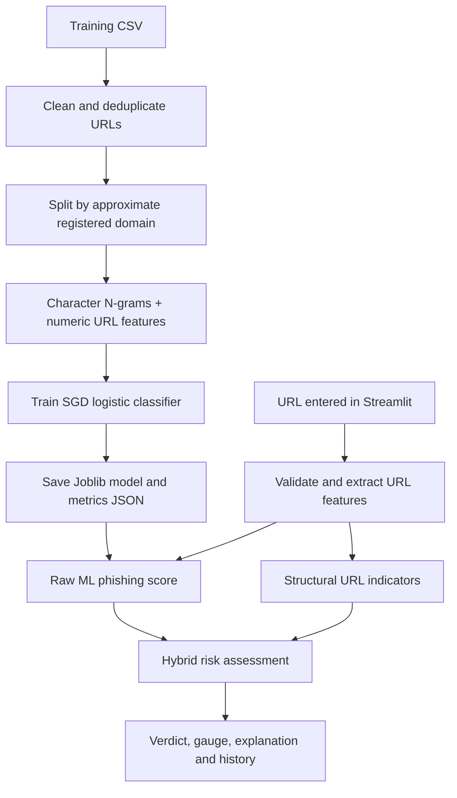

<div align="center">

# 🛡️ ThreatLens

### Explainable Phishing URL Detection with Machine Learning

**Python · scikit-learn · Streamlit · URL Security Analysis**

Analyze a URL without visiting it. ThreatLens combines a character N-gram classifier with URL-structure checks to produce a phishing-risk assessment and human-readable explanation.

[Features](#-features) · [Results](#-model-evaluation) · [Installation](#-getting-started) · [Limitations](#-limitations)

</div>

> **Security note:** ThreatLens analyzes URL text only. A low-risk result does **not** establish that a site is safe, and a high-risk result does **not** confirm a live phishing campaign.

## 🔎 Overview

Phishing URLs often imitate recognizable brands or use misleading hostnames, login paths, and other deceptive patterns. ThreatLens is a B.Tech CSE (AI & ML) project exploring how much can be learned from **the URL string alone**, while making model output understandable to nontechnical users.

The Streamlit dashboard presents a likely-real / likely-fake / uncertain verdict, a risk gauge, indicators, and explanations. The displayed **hybrid risk score** can differ from the raw machine-learning score because structural URL rules and trusted-host heuristics are applied afterward.

## ✨ Features

- **URL scanner:** validates the input and analyzes the URL locally without requesting the website.
- **Machine learning:** hashed character N-grams (3–5) from the normalized full URL, plus numerical URL lexical/domain/path/query features.
- **Domain-grouped evaluation:** separates approximate registered domains across training and test sets to reduce domain leakage.
- **Structural checks:** flags deceptive `@` user-info syntax and possible brand impersonation on unrelated domains.
- **Explainable results:** risk level, suspicious indicators, plain-language verdict, and a visual risk gauge.
- **Dashboard:** Streamlit interface with custom styling and threat-analysis views.
- **Scan history:** SQLite-backed history, filtering, and CSV export in the existing app.
- **Reproducibility:** saves a trained Joblib bundle and a JSON metrics report.

## 🧰 Tech stack

| Component | Technology |
|---|---|
| Language | Python |
| Interface | Streamlit, custom CSS, Plotly |
| ML and feature processing | scikit-learn, pandas, NumPy |
| Model | `HashingVectorizer` + numeric `StandardScaler` + `SGDClassifier(loss="log_loss")` |
| Storage | Joblib, JSON, SQLite |
| Testing | pytest (where included in the project) |

## 🏗️ How it works



**Labels in the trained bundle:** `1 = phishing`, `0 = legitimate`. Source datasets may use different label conventions; preprocessing must map them correctly.

## 📊 Model evaluation

The following results are from the reported training run on `Combined_PhiUSIIL_PhiLegit.csv`, using a **domain-grouped holdout split**. These are **raw model** results, not independently measured performance of the hybrid dashboard rules.

| Metric | Result |
|---|---:|
| Accuracy | **90.38%** |
| Precision (phishing class) | **96.84%** |
| Recall (phishing class) | **82.08%** |
| F1-score (phishing class) | **88.85%** |
| ROC-AUC | **94.91%** |
| False-negative rate | **17.92%** |

**Test set:** 50,980 URLs; **training set:** 204,007 URLs. The reported split contained **36,014 unseen test domains** and **zero approximate registered-domain overlap** between train and test.

| Confusion matrix | Predicted legitimate | Predicted phishing |
|---|---:|---:|
| Actually legitimate | 26,523 | 637 |
| Actually phishing | 4,268 | 19,552 |

**Interpretation:** Precision is high, but the model still misses **4,268 phishing URLs** in this holdout. Do not use it as a sole security control. Domain extraction uses a limited built-in list of multipart suffixes rather than a complete Public Suffix List, so the grouping is approximate.

For the complete machine-readable report, see `models/metrics.json` if included in the repository.

## 🚀 Getting started

### 1. Clone the repository

```bash
git clone https://github.com/adityaprasad567/ThreatLens-Phishing-URL-Detection.git
cd ThreatLens-Phishing-URL-Detection
```

### 2. Create a virtual environment

**Windows PowerShell:**

```powershell
python -m venv .venv
.\.venv\Scripts\Activate.ps1
```

**macOS / Linux:**

```bash
python3 -m venv .venv
source .venv/bin/activate
```

### 3. Install dependencies

```bash
pip install -r requirements.txt
```

### 4. Provide the trained model

The scanner needs `models/best_model.joblib`. If it is not distributed with this repository, train your own model using the instructions below. **Only load Joblib model files from sources you trust.**

### 5. Launch the dashboard

```bash
streamlit run app.py
```

Open the local URL shown in the terminal (typically `http://localhost:8501`).

## 🧪 Dataset and reproducible training

The current reported experiment used the combined file:

```text
data/Combined_PhiUSIIL_PhiLegit.csv
```

The project also references the [PhiUSIIL Phishing URL dataset (UCI)](https://archive.ics.uci.edu/dataset/967/phiusiil+phishing+url+dataset). **The combined CSV is not included in this README**; obtain the datasets from their original sources and check the licenses, label mapping, and preprocessing requirements before combining them.

Place the prepared combined CSV at the path above, then run:

```bash
python -m src.train_model --data data/Combined_PhiUSIIL_PhiLegit.csv
```

Expected generated artifacts:

```text
models/best_model.joblib
models/metrics.json
```

The training script cleans the dataset, creates domain-grouped train/test sets, fits the feature pipeline, evaluates predictions, and records reproducibility metadata. Your exact results may vary if you change the dataset, code, or dependency versions.

> The current training command **requires `--data`**. Older README instructions that omit this argument are outdated.

## 🧫 Example test cases

These examples are useful for testing URL parsing and hybrid rules. `.test` is reserved for testing; the suspicious examples are **synthetic**, not verified malicious websites.

| URL | Expected assessment | Purpose |
|---|---|---|
| `https://github.com/login` | Legitimate hostname | Avoid false positives on login paths |
| `https://accounts.google.com/` | Legitimate hostname | Recognize official subdomain |
| `https://github.com.security-check.test/login` | Suspicious | Brand name embedded in unrelated domain |
| `https://paypal.com.account-check.test/login` | Suspicious | Misleading subdomain |
| `https://github.com@account-verify.test/login` | Suspicious | Deceptive user-info syntax |
| `https://github.com./login` | Legitimate hostname | Trailing-dot hostname normalization |

These checks are **functional examples**, not a substitute for a representative, labeled test set. In particular, a legitimate hostname does not guarantee that every resource it hosts is safe.

## 📸 Dashboard screenshots

Add your actual screenshots under `docs/screenshots/`, then the images below will render on GitHub.

| URL Scanner | Threat Analysis |
|---|---|
|  |  |

| Overview | Model Performance |
|---|---|
|  |  |

## 📁 Main project files

```text
ThreatLens/
├── app.py                         # Streamlit dashboard
├── src/
│   ├── config.py                 # Paths and thresholds
│   ├── feature_extraction.py     # URL validation and features
│   ├── preprocessing.py          # Data cleaning and feature matrix
│   ├── train_model.py            # Domain-grouped training
│   ├── prediction.py             # Raw ML score + hybrid verdict
│   ├── threat_analysis.py        # Indicators and explanations
│   ├── trusted.py                # Recognized hostname checks
│   └── database.py               # Scan history
├── models/
│   ├── best_model.joblib         # Generated trained model (optional in Git)
│   └── metrics.json              # Generated evaluation report
├── data/                          # Training data (normally excluded from Git)
├── tests/                         # Tests, if present
├── requirements.txt
└── README.md
```

## ⚠️ Limitations and responsible use

- **URL-only:** no website content, live redirects, DNS/WHOIS, certificate verification, or reputation feeds are checked.
- **False negatives:** the reported test missed 17.92% of labeled phishing URLs.
- **Hybrid scores are heuristic:** the dashboard's final percentage is not necessarily a calibrated probability. Trusted-host adjustments may reduce false positives but can also conceal risk on compromised or user-content platforms.
- **Dataset bias and drift:** benchmark performance may not generalize to newly created phishing campaigns.
- **Domain grouping is approximate:** use a maintained Public Suffix List implementation for more robust domain extraction.
- **Shortened links:** the destination cannot be assessed reliably without resolving the redirect, which this app intentionally does not do.

Never enter credentials or payment details based solely on a ThreatLens result.

## 🛣️ Roadmap

- [ ] Evaluate the complete hybrid pipeline on an independent labeled dataset
- [ ] Calibrate and validate the displayed risk scores
- [ ] Improve registered-domain parsing with the Public Suffix List
- [ ] Add regression tests for brand impersonation and legitimate login pages
- [ ] Compare against gradient boosting and other baselines
- [ ] Evaluate performance on newer, time-separated phishing data
- [ ] Explore optional live reputation checks, with user consent

## 👨‍💻 Author

**Aditya Prasad**  
[GitHub](https://github.com/adityaprasad567) · [LinkedIn](https://www.linkedin.com/in/aditya-prasad-030431321)

---

*Built as an educational machine-learning and cybersecurity project. Not a replacement for browser protection, organizational security controls, or verified threat intelligence.*
